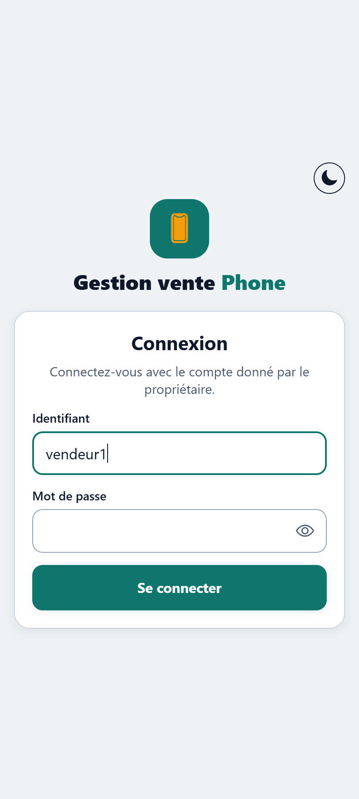
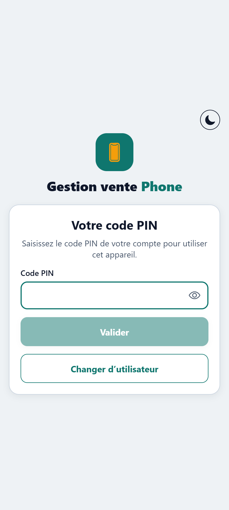

# Guide d'utilisation de GestVente Phone

GestVente Phone sert à vendre des téléphones et des accessoires, suivre chaque téléphone
par son IMEI, gérer la caisse, les trocs, les ventes à crédit et plusieurs boutiques.
L'application fonctionne **même sans Internet** : tout ce que vous faites est gardé sur
l'appareil et part au serveur dès le retour de la connexion.

Chaque fiche explique **une tâche**, pas à pas, avec l'écran correspondant.

## Se repérer dans l'application

- **La barre du bas** est toujours visible : **Accueil**, **Stock**, le gros bouton jaune
  **Vendre** au centre, **Clients** et **Menu**. Un appui ramène toujours au même écran.
- **L'accueil** montre les chiffres du jour et 8 grandes tuiles pour les gestes de tous les
  jours : Vendre, Caisse, Ventes, Crédits, Stock, Clients, Retours, Dépenses.
- **Le Menu** range toutes les autres options par thème (vente, troc, stock, clients,
  gestion, réglages). Une pastille rouge signale ce qui attend une action.
- **Le bouton ☀️ / 🌙** en haut à droite passe l'application en mode clair ou sombre ; le
  choix reste sur l'appareil.

## Concepteur (gestion des commerçants abonnés)

L'espace concepteur s'ouvre uniquement par l'adresse `/plateforme` du site (aucun lien sur
l'écran des commerçants). Barre du bas : **Commerçants**, gros bouton **+ Nouveau**,
**Tableau de bord**, **Quitter**. Création d'un commerçant, abonnements, verrouillage d'une
boutique et nouveau mot de passe du propriétaire se font depuis la fiche du commerce.

- **Comptes** (onglet du bas) : créer un autre concepteur (mot de passe provisoire affiché une
  fois, à changer à la première connexion), l'aider à se reconnecter (nouveau mot de passe
  provisoire ; « téléphone perdu » retire aussi sa double authentification), le désactiver
  ou supprimer son compte. Supprimer un compte ne supprime rien de ce qu'il a créé
  (commerces, abonnements…). Il reste toujours au moins un concepteur actif.
- **Mots de passe oubliés** : quand un commerçant touche « Mot de passe oublié ? », une
  pastille rouge apparaît sur l'onglet **Commerçants** et un bandeau sur l'accueil (relu
  chaque minute). Ouvrez **Voir les demandes** : nom, identifiant, commerce et numéro laissé.
  **Donner un nouveau mot de passe** affiche un mot de passe provisoire **une seule fois** :
  transmettez-le par **WhatsApp** ou **appel** (boutons prêts), jamais dans un groupe.
  **Ignorer** classe une demande sans suite.
- **Contact affiché aux commerçants** (même écran) : nom, téléphone, WhatsApp et e-mail
  montrés sur l'écran « Mot de passe oublié » pour vous joindre directement.
- **Appareils autorisés** : chaque ordinateur, téléphone ou tablette doit être autorisé.
  Fiche du commerce → **Appareils autorisés** (code pour le nouvel appareil d'un commerçant
  ou d'un employé, retrait de l'ancien) ; **Comptes** → **Appareils autorisés des
  concepteurs** (code pour un autre concepteur). Voir
  [le guide pas à pas](appareils-autorises.md).
- **Mon compte** : changer son mot de passe (10 caractères, lettres et chiffres) et activer la
  **double authentification** : installez Google Authenticator, scannez le code QR, saisissez
  le code à 6 chiffres. Ensuite, chaque connexion demande ce code après le mot de passe.

## Vendeur

1. [Vendre](vendeur/01-vendre.md)
2. [Faire un troc (reprendre l'ancien téléphone)](vendeur/02-troc.md)
3. [Encaisser une tranche de crédit](vendeur/03-encaisser-une-tranche.md)
4. [Ouvrir et fermer la caisse](vendeur/04-caisse.md)
5. [Que faire hors ligne](vendeur/05-hors-ligne.md)

## Gérant

1. [Suivre le stock](gerant/01-stock.md)
2. [Faire un inventaire](gerant/02-inventaire.md)
3. [Traiter un retour ou un échange](gerant/03-retours.md)
4. [Transférer du stock entre boutiques](gerant/04-transferts.md)
5. [Suivre les crédits](gerant/05-credits.md)

## Propriétaire

1. [Créer et gérer les boutiques](proprietaire/01-boutiques.md)
2. [Gérer les employés](proprietaire/02-employes.md)
3. [Fixer les prix](proprietaire/03-prix.md)
4. [Lire les rapports et le tableau de bord](proprietaire/04-rapports.md)
5. [Appareil perdu ou volé](proprietaire/05-appareil-perdu.md)
6. [Appareils autorisés : nouvel appareil, retirer un appareil](appareils-autorises.md)

## Formation

- [Formation des vendeurs (1 heure, avec exercices)](formation-vendeurs.md)
- [Aide-mémoire à afficher en boutique](aide-memoire.md)

## Avant de commencer

**Se connecter.** Le propriétaire vous donne un identifiant et un mot de passe
provisoire. À la première connexion sur un appareil, vous choisissez un **code PIN** de
4 à 6 chiffres : il sert ensuite à déverrouiller l'application, même sans Internet.

**Nouvelle version.** Après une mise à jour du site, un bandeau **« Nouvelle version
disponible »** apparaît en haut de l'écran (navigateur, ou application installée sur le
téléphone ou l'ordinateur). Touchez **Mettre à jour** : l'application se recharge sur la
nouvelle version, sans rien perdre (les ventes pas encore envoyées restent sur l'appareil).
**Plus tard** cache le bandeau 30 minutes. La version installée est indiquée en bas du
**Menu**.

**Mot de passe oublié ?** Touchez ce bouton sous « Se connecter », saisissez votre
identifiant (et, si vous voulez, un numéro pour être rappelé), puis **Envoyer la demande au
concepteur**. Le concepteur reçoit la demande et vous donne un nouveau mot de passe. Sur le
même écran, ses coordonnées (**Appeler**, **WhatsApp**, e-mail) permettent de le joindre
directement. Employé : votre propriétaire peut aussi vous donner un nouveau mot de passe
(Menu → Équipe).

| Connexion                                   | Code PIN                    |
| ------------------------------------------- | --------------------------- |
|  |  |

**Le bandeau du haut** indique l'état de la synchronisation :

- point vert **En ligne** : tout est envoyé ;
- **Hors ligne** : vous pouvez continuer à travailler, rien n'est perdu ;
- un nombre d'**opérations en attente** : elles partiront au retour du réseau.

**Qui voit quoi.** Le vendeur vend, fait les trocs et encaisse ; il ne modifie jamais
les prix. Le gérant gère le stock, les retours, les transferts et les crédits de sa ou
ses boutiques. Le propriétaire voit tout : boutiques, employés, prix, rapports.

> Données de démonstration : boutique « Adil Phone Madina », comptes `vendeur1`,
> `vendeur2`, `gerant`, `proprietaire` (mot de passe fourni par le formateur, PIN 2580).
> Elles servent aux exercices de la [formation](formation-vendeurs.md).
