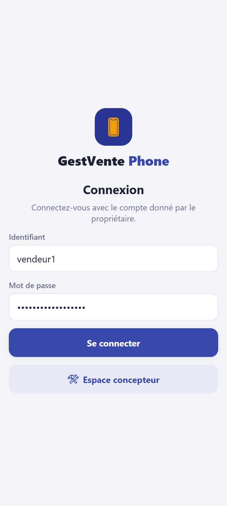
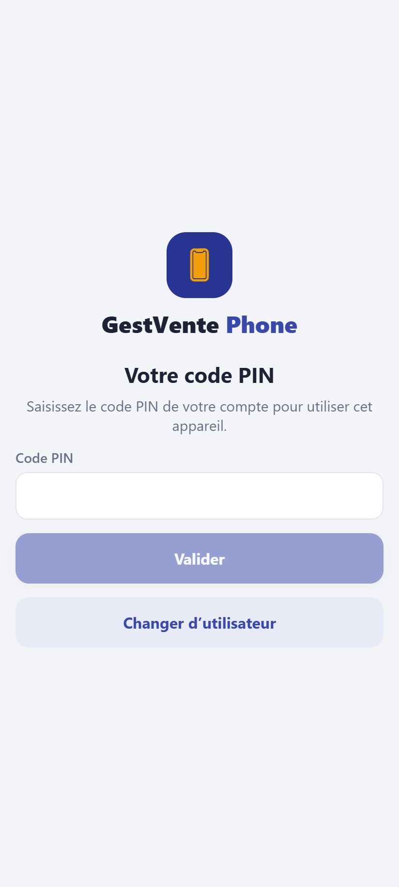

# Guide d'utilisation de GestVente Phone

GestVente Phone sert à vendre des téléphones et des accessoires, suivre chaque téléphone
par son IMEI, gérer la caisse, les trocs, les ventes à crédit et plusieurs boutiques.
L'application fonctionne **même sans Internet** : tout ce que vous faites est gardé sur
l'appareil et part au serveur dès le retour de la connexion.

Chaque fiche explique **une tâche**, pas à pas, avec l'écran correspondant.

## Vendeur

1. [Vendre](vendeur/01-vendre.md)
2. [Faire un troc (reprendre l'ancien téléphone)](vendeur/02-troc.md)
3. [Encaisser une tranche de crédit](vendeur/03-encaisser-une-tranche.md)
4. [Ouvrir et fermer la caisse](vendeur/04-caisse.md)
5. [Que faire hors ligne](vendeur/05-hors-ligne.md)

## Gérant

1. [Suivre le stock](gerant/01-stock.md)
2. [Faire un inventaire](gerant/02-inventaire.md)
3. [Traiter un retour ou un échange](gerant/03-retours.md)
4. [Transférer du stock entre boutiques](gerant/04-transferts.md)
5. [Suivre les crédits](gerant/05-credits.md)

## Propriétaire

1. [Créer et gérer les boutiques](proprietaire/01-boutiques.md)
2. [Gérer les employés](proprietaire/02-employes.md)
3. [Fixer les prix](proprietaire/03-prix.md)
4. [Lire les rapports et le tableau de bord](proprietaire/04-rapports.md)
5. [Appareil perdu ou volé](proprietaire/05-appareil-perdu.md)

## Formation

- [Formation des vendeurs (1 heure, avec exercices)](formation-vendeurs.md)
- [Aide-mémoire à afficher en boutique](aide-memoire.md)

## Avant de commencer

**Se connecter.** Le propriétaire vous donne un identifiant et un mot de passe
provisoire. À la première connexion sur un appareil, vous choisissez un **code PIN** de
4 à 6 chiffres : il sert ensuite à déverrouiller l'application, même sans Internet.

| Connexion                                   | Code PIN                    |
| ------------------------------------------- | --------------------------- |
|  |  |

**Le bandeau du haut** indique l'état de la synchronisation :

- point vert **En ligne** : tout est envoyé ;
- **Hors ligne** : vous pouvez continuer à travailler, rien n'est perdu ;
- un nombre d'**opérations en attente** : elles partiront au retour du réseau.

**Qui voit quoi.** Le vendeur vend, fait les trocs et encaisse ; il ne modifie jamais
les prix. Le gérant gère le stock, les retours, les transferts et les crédits de sa ou
ses boutiques. Le propriétaire voit tout : boutiques, employés, prix, rapports.

> Données de démonstration : boutique « Adil Phone Madina », comptes `vendeur1`,
> `vendeur2`, `gerant`, `proprietaire` (mot de passe fourni par le formateur, PIN 2580).
> Elles servent aux exercices de la [formation](formation-vendeurs.md).
