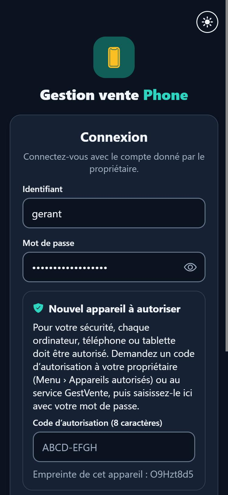
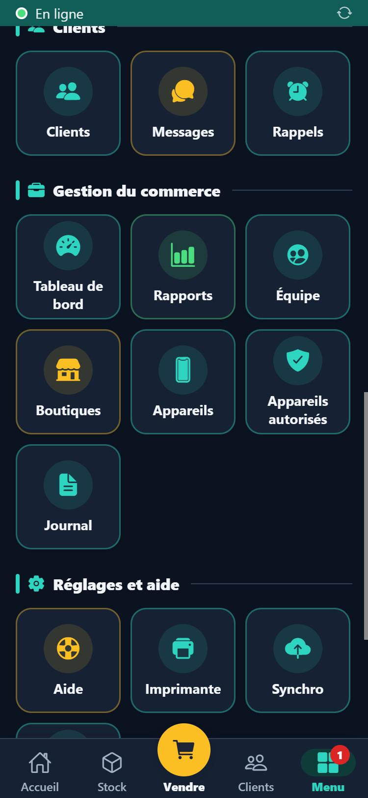
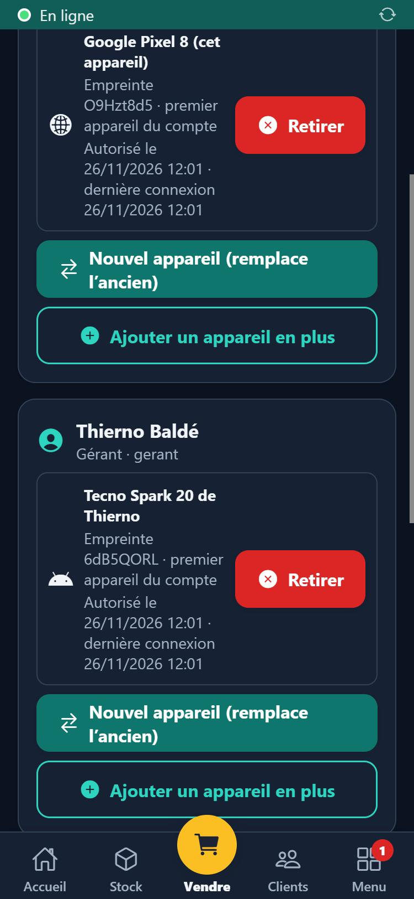
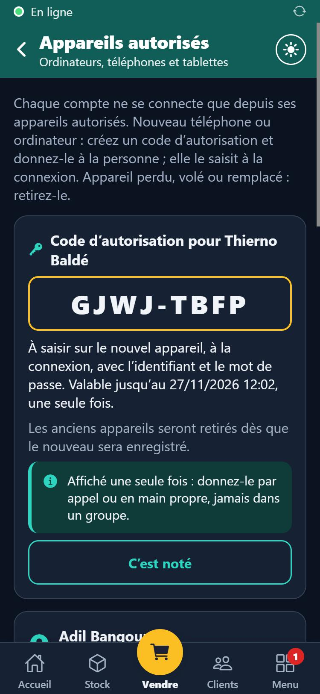
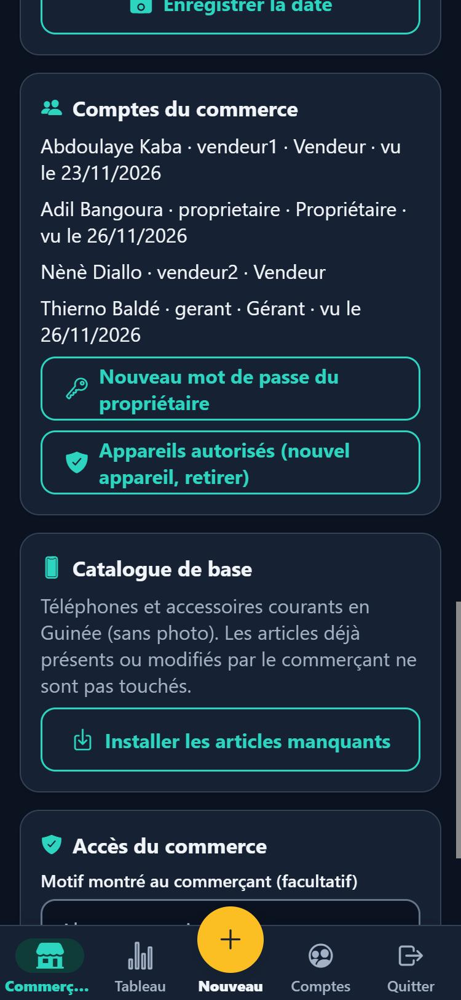
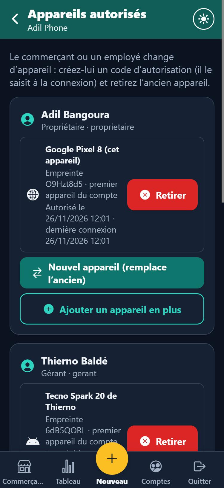

# Appareils autorisés : guide pas à pas

Depuis cette version, **chaque appareil doit être autorisé** pour ouvrir l'application :
ordinateur, téléphone Android, iPhone ou tablette. L'identifiant et le mot de passe ne
suffisent plus : quelqu'un qui les a volés ne peut pas se connecter depuis son propre
appareil.

## 1. Comment ça marche

- À sa première utilisation, chaque appareil crée sa **clé secrète**. Cette clé **ne quitte
  jamais l'appareil** : ni le serveur, ni le concepteur, ni personne ne peut la lire.
- À chaque connexion, l'appareil prouve qu'il détient cette clé, **en plus** de
  l'identifiant et du mot de passe. Le serveur reconnaît ainsi l'appareil.
- Le **tout premier appareil** d'un compte est autorisé d'office.
- Pour **chaque nouvel appareil**, il faut un **code d'autorisation** de 8 caractères (par
  exemple `GJWJ-TBFP`). Il est donné par un administrateur, **valable 24 heures** et
  **utilisable une seule fois**.
- Un appareil **retiré** (perdu, volé, remplacé) est déconnecté **aussitôt** et ne peut
  plus revenir sans nouveau code.

| Qui change d'appareil ?   | Qui donne le code et retire l'ancien appareil ?                                 |
| ------------------------- | ------------------------------------------------------------------------------- |
| Vendeur                   | Le **propriétaire**, le **gérant** de sa boutique, ou un **concepteur**         |
| Gérant                    | Le **propriétaire** ou un **concepteur**                                        |
| Propriétaire (commerçant) | Le propriétaire lui-même depuis un appareil déjà autorisé, ou un **concepteur** |
| Concepteur                | Un **autre concepteur**, ou la commande de secours du serveur (§ 7)             |

> Les appareils **déjà connectés** au moment de la mise à jour restent autorisés : personne
> n'a rien à faire. Seuls les nouveaux appareils demandent un code.

## 2. Se connecter sur un nouvel appareil (tout le monde)

1. Ouvrez l'application, ou le site dans le navigateur.
2. Saisissez votre **identifiant** et votre **mot de passe**, puis touchez **Se connecter**.
3. Le message **« Nouvel appareil à autoriser »** s'affiche. Notez l'**empreinte de cet
   appareil** (par exemple `O9Hzt8d5`) : elle permet de le reconnaître dans la liste.
4. Demandez un **code d'autorisation** à la bonne personne (tableau ci-dessus), **par
   téléphone** de préférence.
5. Saisissez le code (majuscules ou minuscules, avec ou sans tiret), puis touchez
   **Autoriser cet appareil et se connecter**.
6. Saisissez votre **code PIN** : l'appareil est prêt.



**Code refusé ?** Il est peut-être expiré (plus de 24 heures), déjà utilisé, ou remplacé par
un code plus récent. Demandez-en un nouveau.

## 3. Autoriser le nouvel appareil d'un employé (propriétaire ou gérant)

1. **Menu** → **Appareils autorisés** (rubrique « Gestion du commerce »).

   

2. Chaque personne a sa carte, avec ses appareils autorisés : nom de l'appareil,
   **empreinte**, date d'autorisation et dernière connexion. Votre appareil est marqué
   **(cet appareil)**.

   

3. Sur la carte de la personne, choisissez :
   - **Nouvel appareil (remplace l'ancien)** : elle change de téléphone ou d'ordinateur.
     Dès que le nouvel appareil est enregistré, les anciens sont **retirés
     automatiquement** ;
   - **Ajouter un appareil en plus** : elle garde ses appareils et en utilise un de plus
     (par exemple le téléphone et l'ordinateur de la caisse).
4. Confirmez. Le **code** s'affiche **une seule fois**, en grand.

   

5. Donnez-le à la personne **par appel ou en main propre**, jamais dans un groupe. Elle
   suit le § 2.
6. Touchez **C'est noté**. La carte indique « Code en attente » jusqu'à son utilisation.

> Un gérant gère les appareils des **vendeurs de ses boutiques**, jamais ceux du
> propriétaire ni d'un autre gérant.

## 4. Retirer un appareil perdu, volé ou vendu

1. **Menu** → **Appareils autorisés**.
2. Sur la carte de la personne, touchez **Retirer** à côté de l'appareil concerné, puis
   confirmez.
3. L'appareil est **déconnecté aussitôt**. Il ne pourra plus se connecter, même avec le bon
   mot de passe, sauf avec un nouveau code.

Les appareils retirés restent visibles (bouton **Appareils retirés**) avec la date et la
personne qui les a retirés. Chaque action est aussi notée dans le **Journal**.

> Téléphone volé : retirez l'appareil **et** changez le mot de passe de la personne
> (**Équipe** → la personne → nouveau mot de passe).

## 5. Le propriétaire change lui-même de téléphone

- **Il a encore l'ancien appareil** : depuis l'ancien, **Menu** → **Appareils autorisés** →
  sa propre carte → **Nouvel appareil (remplace l'ancien)**. Il saisit ce code sur le
  nouveau téléphone (§ 2).
- **Il n'a plus l'ancien appareil** (perdu, volé, en panne) : il appelle le **service
  GestVente**. Un concepteur lui crée le code (§ 6).

## 6. Espace concepteur : aider un commerçant

1. **Commerçants** → ouvrez le commerce.
2. Carte **Comptes du commerce** → **Appareils autorisés (nouvel appareil, retirer)**.

   

3. Tous les comptes du commerce apparaissent : propriétaire, gérants, vendeurs. Pour la
   personne qui change d'appareil, choisissez **Nouvel appareil (remplace l'ancien)** ou
   **Ajouter un appareil en plus**, puis donnez le code par téléphone.
4. Appareil perdu ou volé : **Retirer**.

   

## 7. Espace concepteur : aider un autre concepteur

1. **Comptes** (barre du bas) → **Appareils autorisés des concepteurs**.
2. Sur la carte du concepteur qui change d'appareil : **Nouvel appareil (remplace
   l'ancien)**. Donnez-lui le code par téléphone ; il le saisit à la connexion de l'espace
   concepteur, avec son mot de passe (puis son code de double authentification s'il l'a
   activée).
3. Appareil perdu : **Retirer**. Sa session sur cet appareil se ferme aussitôt.

**Secours (un seul concepteur, plus aucun appareil autorisé).** Sur le serveur, en SSH, dans
le dossier de l'API :

```
node dist/cli/code-appareil.js identifiant-du-concepteur
```

La commande affiche un code valable 24 heures, qui remplace les anciens appareils de ce
concepteur.

## 8. Ordinateurs, téléphones et tablettes

| Appareil                                         | Où est gardée la clé                                     |
| ------------------------------------------------ | -------------------------------------------------------- |
| Ordinateur (Windows, Mac) dans le navigateur     | Le navigateur, clé non copiable (Chrome, Edge, Firefox…) |
| Site installé (téléphone ou PC, icône d'accueil) | Le navigateur qui l'a installé                           |
| Application Android, iPhone ou tablette          | Le coffre sécurisé du téléphone                          |

**Comptent comme un nouvel appareil** (il faut un code) :

- un **autre navigateur** sur le même ordinateur (Chrome puis Edge, par exemple) ;
- la **navigation privée** (la clé est effacée à la fermeture : à éviter) ;
- après **« Effacer les données du site »** ou un nettoyage complet du navigateur ;
- après une **désinstallation** de l'application ou une remise à zéro du téléphone.

**Conseils**

- Gardez un seul navigateur par poste de travail pour l'application.
- Ne prêtez pas un appareil autorisé : retirez-le avant de le donner ou de le vendre.
- Le code d'autorisation est inutile sans le mot de passe, et le mot de passe est inutile
  sans un appareil autorisé : ne donnez jamais les deux ensemble par écrit.

## 9. Questions fréquentes

**J'ai un nouveau téléphone et l'ancien marche encore.** Demandez un code « Nouvel appareil
(remplace l'ancien) » : l'ancien sera retiré dès que le nouveau sera enregistré.

**Je travaille sur le téléphone et sur l'ordinateur de la boutique.** Demandez « Ajouter un
appareil en plus » : les deux restent autorisés.

**Le code ne marche pas.** Il a expiré (24 heures), a déjà servi, ou un code plus récent
l'a remplacé. Demandez-en un nouveau.

**Un employé est parti.** Désactivez son compte (**Équipe**) et retirez ses appareils.

**Qui voit ma clé ?** Personne : elle reste dans votre appareil. Le serveur ne garde que la
partie publique, qui sert seulement à vérifier.
