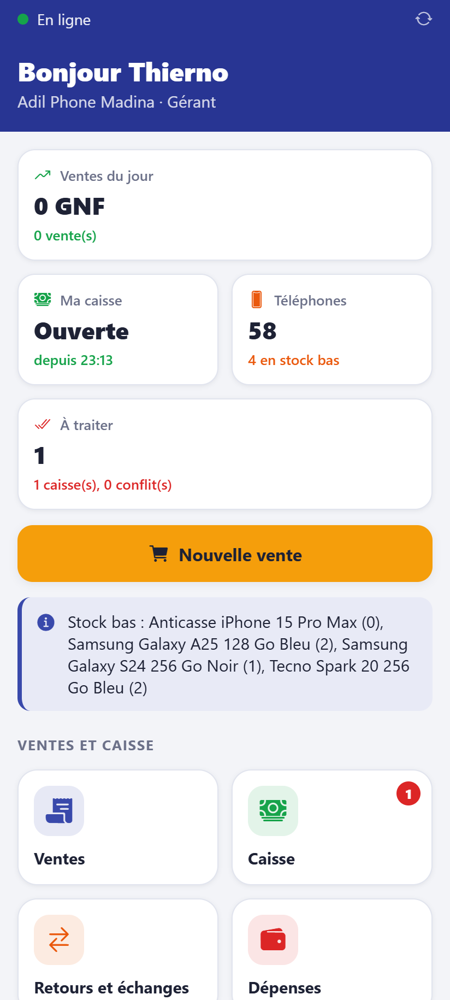
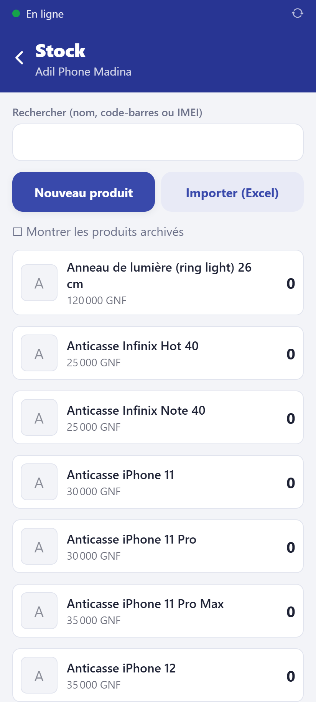
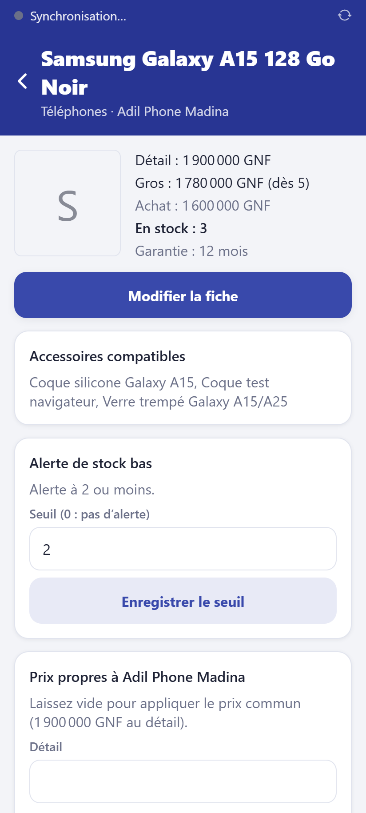
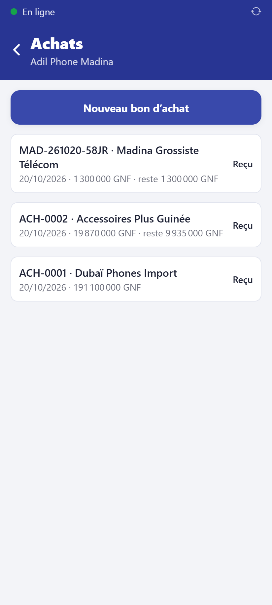
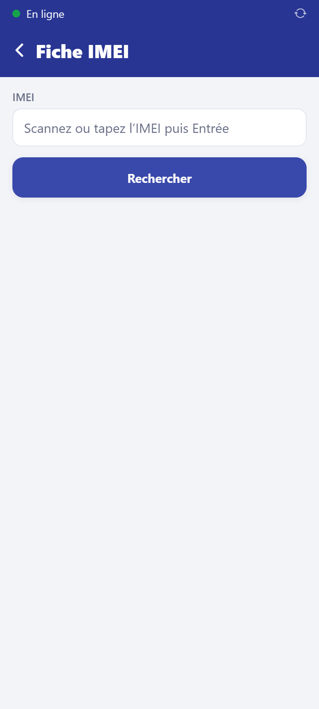
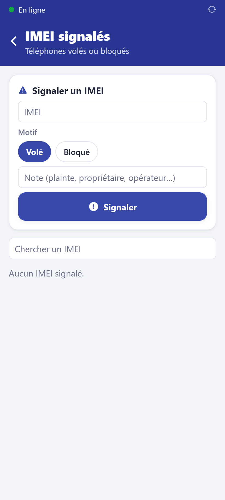

# Suivre le stock

**Qui :** gérant et propriétaire (le vendeur consulte seulement).

L'accueil du gérant regroupe le stock, les achats, l'inventaire et les transferts.

## L'écran Stock

Accueil → **Stock**. Recherche par nom, code-barres ou IMEI ; bouton **Scanner un code**
sur téléphone. Les produits sous leur seuil d'alerte sont signalés, et rappelés sur
l'accueil (« Stock bas »).

## La fiche d'un produit

Touchez un produit : quantité en stock, téléphones présents avec leur IMEI, prix.

- **Alerte de stock bas** : fixez le **seuil** (0 = pas d'alerte), **Enregistrer le seuil**.
- **Ajuster la quantité** d'un accessoire (ex. `-2` pour une casse, `5` pour une
  trouvaille) avec un **motif** obligatoire. L'ajustement est inscrit au journal.
- **Sortir du stock** un téléphone (perte, casse, vol) avec un motif.
- Un téléphone **à réparer** (repris en troc) se remet en vente depuis l'écran **Trocs**.

## Recevoir une commande fournisseur

Accueil → **Achats** → **Nouveau bon d'achat** : fournisseur, produits, quantités, prix
d'achat. À la livraison, ouvrez le bon et **réceptionnez** : scannez les IMEI des
téléphones (en rafale), comptez les accessoires. Le stock augmente à la réception.

## Fiche IMEI

Accueil → **Fiche IMEI** : l'historique complet d'un téléphone (achat, ventes, retours,
troc, transferts, garantie).

## IMEI signalés

Accueil → **IMEI signalés** : la liste des téléphones volés ou bloqués connus du
commerce. Un IMEI de cette liste ne peut pas être repris en troc. Le gérant ajoute un
IMEI (motif, note) ou lève un signalement.

