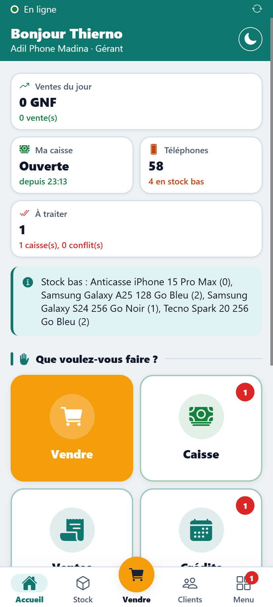
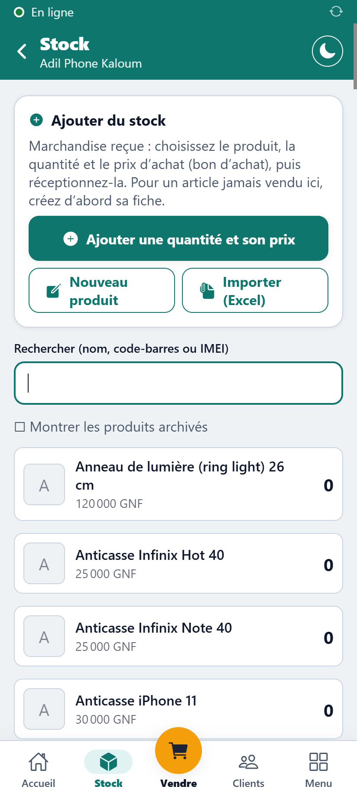
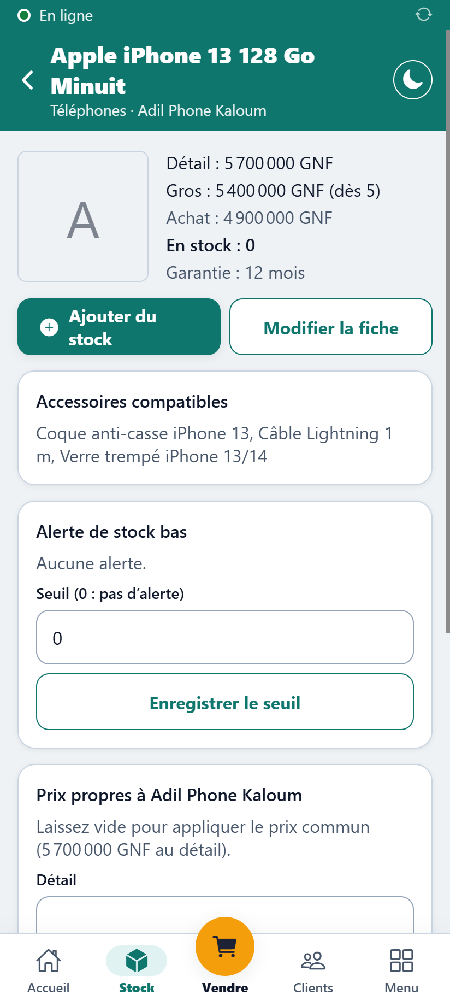
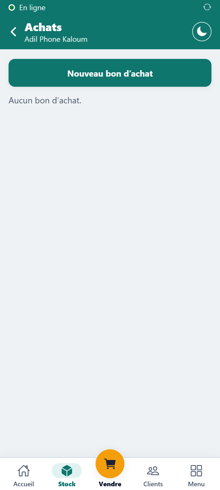
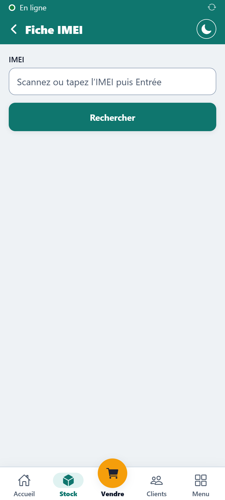
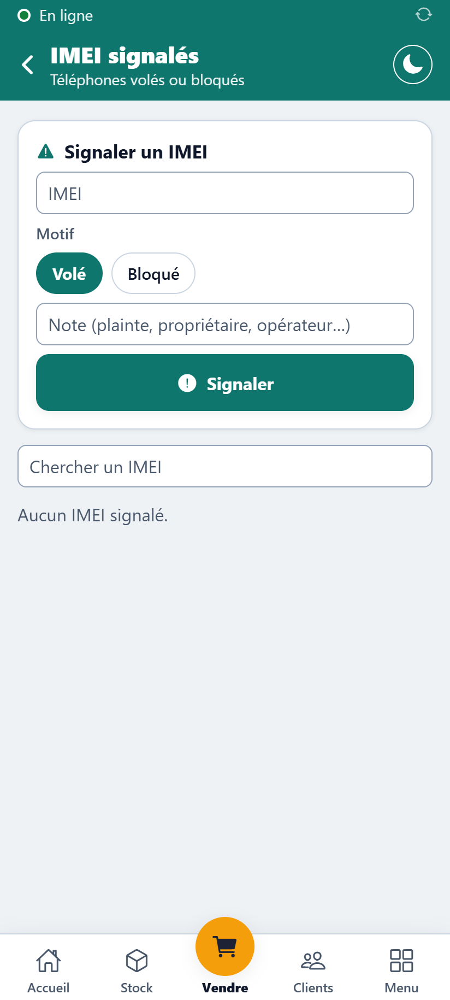

# Suivre le stock

**Qui :** gérant et propriétaire (le vendeur consulte seulement).

Le **Menu** (onglet en bas à droite) regroupe le stock, les achats, l'inventaire et les transferts ; le stock est aussi un onglet de la barre du bas.

## L'écran Stock

Accueil → **Stock**. Recherche par nom, code-barres ou IMEI ; bouton **Scanner un code**
sur téléphone. Les produits sous leur seuil d'alerte sont signalés, et rappelés sur
l'accueil (« Stock bas »).

## La fiche d'un produit

Touchez un produit : quantité en stock, téléphones présents avec leur IMEI, prix.

- **Alerte de stock bas** : fixez le **seuil** (0 = pas d'alerte), **Enregistrer le seuil**.
- **Ajuster la quantité** d'un accessoire (ex. `-2` pour une casse, `5` pour une
  trouvaille) avec un **motif** obligatoire. L'ajustement est inscrit au journal.
- **Sortir du stock** un téléphone (perte, casse, vol) avec un motif.
- Un téléphone **à réparer** (repris en troc) se remet en vente depuis l'écran **Trocs**.

## Ajouter du stock (quantité et prix d'achat)

En haut de l'écran **Stock**, bouton **Ajouter une quantité et son prix** (ou, sur la fiche
d'un produit, **Ajouter du stock**). Le bon se remplit comme un tableau : une ligne par
article (quantité, prix d'achat, total). Le **numéro du bon est donné automatiquement**.
Choisissez le fournisseur dans la **liste déroulante**, ou « Nouveau fournisseur » pour le
créer sur place.

À la livraison, ouvrez le bon et **validez la réception** : la quantité reçue est déjà
remplie (corrigez-la si besoin). Les **IMEI sont facultatifs** (bouton « Ajouter les IMEI »).
Indiquez au même endroit le **montant payé**, le **mode de paiement** et la **référence** si
besoin. Le stock augmente à la réception.

**Bons d'achat** (bouton de l'écran Stock, ou Menu → **Bons d'achat**) : tous les bons, à
recevoir ou reçus, avec une recherche par numéro ou fournisseur. **Modifier** corrige un bon,
même déjà reçu (fournisseur, prix, quantités commandées, sans descendre sous ce qui est reçu).

**Nouveau produit** : la fiche propose un **stock de départ** (quantité et fournisseur) ; le
bon d'achat correspondant est créé et reçu automatiquement.

## Fiche IMEI

Menu → **Chercher IMEI** : l'historique complet d'un téléphone (achat, ventes, retours,
troc, transferts, garantie).

## IMEI signalés

Menu → **Volés (IMEI)** : la liste des téléphones volés ou bloqués connus du
commerce. Un IMEI de cette liste ne peut pas être repris en troc. Le gérant ajoute un
IMEI (motif, note) ou lève un signalement.

