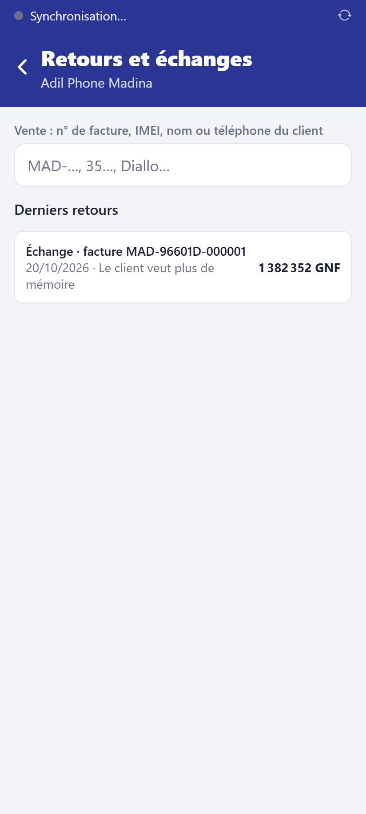

# Traiter un retour ou un échange

**Qui :** le gérant ; un vendeur peut le saisir, mais le gérant le valide avec son code
PIN (en ligne). **Réseau :** pas nécessaire pour le gérant.

## Les règles du commerce

- Retour ou échange dans le **délai** du commerce après la vente (7 jours par défaut).
- Un appareil **endommagé par le client** est refusé.
- Après le délai, seul un appareil **en panne sous garantie** s'échange.
- Une vente **à crédit** ne se retourne pas dans l'application : le gérant règle le cas
  avec le client et le propriétaire. Une vente avec un **troc** se retourne, mais ne
  s'annule pas (l'ancien téléphone est déjà dans le stock).

## Pas à pas

1. Accueil → **Retours et échanges**.
2. Retrouvez la vente : **n° de facture, IMEI, nom ou téléphone du client** (ou
   **Scanner l'IMEI**).

3. Cochez les **articles rendus**, l'**état de l'appareil** (intact, défectueux,
   endommagé) et le **motif**.
4. Choisissez ce que **le client reçoit** :
   - **remboursement** (espèces, Orange Money, MTN MoMo, virement — sortie de caisse) ;
   - **avoir** : un crédit au nom du client, utilisable à sa prochaine vente ;
   - **échange** : ajoutez les **articles remis au client** ; la valeur rendue est
     déduite et le client paie la différence (ou on lui rend le surplus).
5. Choisissez le **devenir** de chaque article : remis en stock (neuf), occasion (avec
   un prix de revente) ou rebut.
6. Si vous êtes vendeur : **Validation du gérant** (identifiant et code PIN du gérant,
   **Faire valider**).
7. Confirmez.

## À savoir

- Chaque retour est inscrit au journal d'audit et dans la fiche IMEI du téléphone.
- Les rapports déduisent les retours du chiffre d'affaires du jour du retour.
