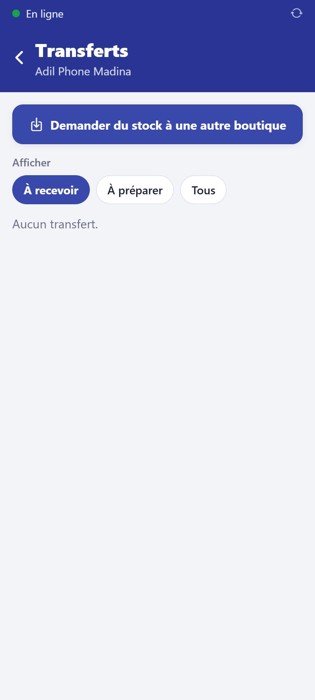

# Transférer du stock entre boutiques

**Qui :** gérant et propriétaire ; la réception peut être faite par un vendeur.
**Réseau :** pas nécessaire (l'autre boutique reçoit l'information à la synchronisation).

## 1. La boutique qui manque de stock demande

Accueil → **Transferts** → **Demander du stock à une autre boutique** : choisissez la
boutique qui envoie, les produits et les quantités, puis **Envoyer la demande**.

## 2. La boutique de départ prépare et envoie

Dans **Transferts**, onglet **À préparer**, ouvrez la demande :

- **scannez les téléphones** qui partent (seuls ceux en stock ici sont acceptés) ;
- vérifiez la **quantité** de chaque accessoire ;
- touchez **Envoyer**.

Les téléphones passent **en transfert** (ils ne peuvent plus être vendus) et le stock de
départ diminue tout de suite.

Le propriétaire peut aussi **envoyer directement**, sans demande.

## 3. La boutique d'arrivée réceptionne

Onglet **À recevoir** (un badge apparaît sur la tuile de l'accueil), ouvrez le transfert :

1. **Scannez chaque téléphone** reçu ; comptez les accessoires.
2. Les **écarts** s'affichent avant de confirmer (téléphone manquant, coque cassée…) :
   notez-les dans la **remarque**.
3. **Confirmer la réception**.

Le stock d'arrivée n'augmente **qu'à ce moment-là**, et seulement de ce qui a été reçu.
Un téléphone manquant reste « en transfert » : cherchez-le avec la boutique de départ.

## Annuler

Une demande s'annule depuis l'une ou l'autre boutique ; un envoi pas encore reçu,
depuis la boutique de départ (tout revient en stock). Un motif est demandé.

## Historique

Chaque transfert apparaît dans la fiche IMEI des téléphones : numéro, boutique de départ
et d'arrivée.
