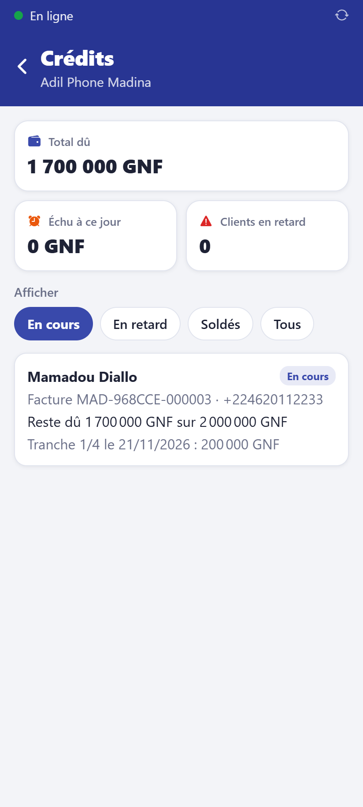
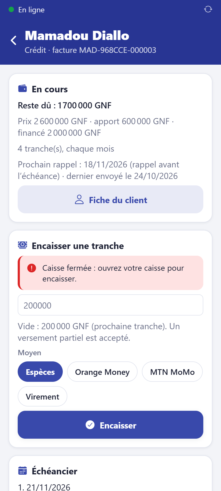

# Suivre les crédits

**Qui :** gérant et propriétaire (le vendeur encaisse les tranches).

## Le tableau des crédits

Accueil → **Crédits** : **Total dû**, **Échu à ce jour**, **Clients en retard**. Filtres
**En cours**, **En retard**, **Soldés**, **Tous**. Les plus en retard sont en tête.

## La fiche d'un crédit

- reste dû, prix, apport, montant financé, garant ;
- **prochain rappel** prévu et date du dernier rappel envoyé ;
- échéancier : chaque tranche, payée, partiellement payée, ou **en retard** ;
- versements, avec le bouton **Reçu** pour réimprimer ;
- **Contrat de crédit (A4)** à imprimer en deux exemplaires et à faire signer.

## Rappels et relances

Chaque matin à 9 h, le client reçoit automatiquement :

- un rappel quelques jours **avant** l'échéance (3 jours par défaut) ;
- un rappel **le jour** de l'échéance ;
- une **relance** tous les 7 jours en cas de retard (4 au plus par défaut).

Le bouton **Relancer maintenant** envoie un message tout de suite (en ligne).

Le propriétaire règle les rappels et la **pénalité de retard** (montant fixe ou % de la
tranche, après un délai de grâce) dans **Crédits → Rappels et pénalités**.

## Accorder un crédit

- Le propriétaire fixe le **plafond** de crédit sur la fiche du client.
- La fiche doit être complète : téléphone, pièce d'identité, adresse ; garant facultatif.
- Le crédit est refusé si l'encours du client plus le nouveau crédit dépasse son plafond.
