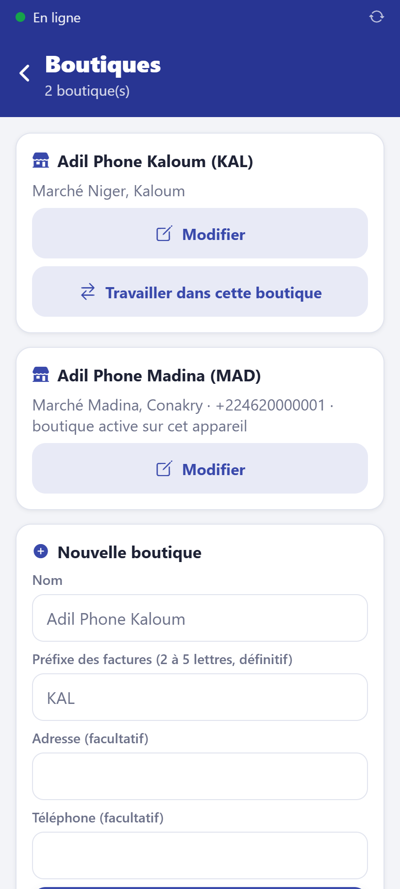

# Créer et gérer les boutiques

**Qui :** le propriétaire. **Réseau :** nécessaire.

Accueil → **Boutiques**. Vous créez autant de boutiques que vous voulez.

## Créer une boutique

Dans **Nouvelle boutique** :

- **Nom** (ex. « Adil Phone Kaloum ») ;
- **Préfixe des factures** : 2 à 5 lettres (ex. `KAL`), **définitif** car il figure sur
  toutes les factures de la boutique ;
- adresse et téléphone (imprimés sur les reçus et factures).

Touchez **Créer la boutique**, puis rattachez-y des employés dans
[Équipe](02-employes.md). Le catalogue est commun à toutes les boutiques ; le stock, les
prix propres, les caisses et les ventes sont séparés.

## Modifier

**Modifier** : nom, adresse, téléphone.

## Travailler dans une autre boutique

Le propriétaire et un employé rattaché à plusieurs boutiques changent de boutique active
avec **Travailler dans cette boutique** (ou depuis l'accueil). Chaque appareil ne reçoit que
les données des boutiques de son utilisateur.

## Le catalogue de base

À l'ouverture du compte, le catalogue contient déjà les téléphones et accessoires courants
en Guinée (iPhone, Samsung, Tecno, Itel, Infinix…) avec des prix indicatifs. Il suffit de
saisir les quantités (bons d'achat ou inventaire) et d'ajuster les prix.
