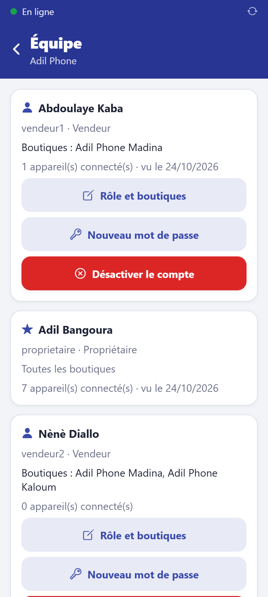

# Gérer les employés

**Qui :** le propriétaire (le gérant consulte l'équipe de ses boutiques). **Réseau :**
nécessaire.

Accueil → **Équipe**.

## Créer un compte

Dans **Nouvel employé** :

1. **Nom complet**, **identifiant de connexion** (ex. `aissatou`), téléphone facultatif.
2. **Rôle** :
   - **Vendeur** : vend, fait les trocs, encaisse les tranches ; ne modifie jamais les prix ;
   - **Gérant** : en plus, stock, inventaire, retours, transferts, crédits, validation des
     remises et des caisses de ses boutiques.
3. **Boutiques** : une ou plusieurs.
4. **Créer le compte**.

Le **mot de passe provisoire** s'affiche **une seule fois** : notez-le et donnez-le à
l'employé avec son identifiant. À sa première connexion, il choisit son code PIN.

## Modifier

- **Rôle et boutiques** : l'effet est immédiat ; les données d'une boutique retirée
  quittent ses appareils à la synchronisation suivante.
- **Nouveau mot de passe** : mot de passe oublié ; ses appareils sont déconnectés.
- **Désactiver le compte** : départ de l'employé ; il est déconnecté de tous ses appareils
  et ne peut plus se connecter. Ses ventes restent dans l'historique.

Toutes ces actions sont inscrites au journal d'audit.
