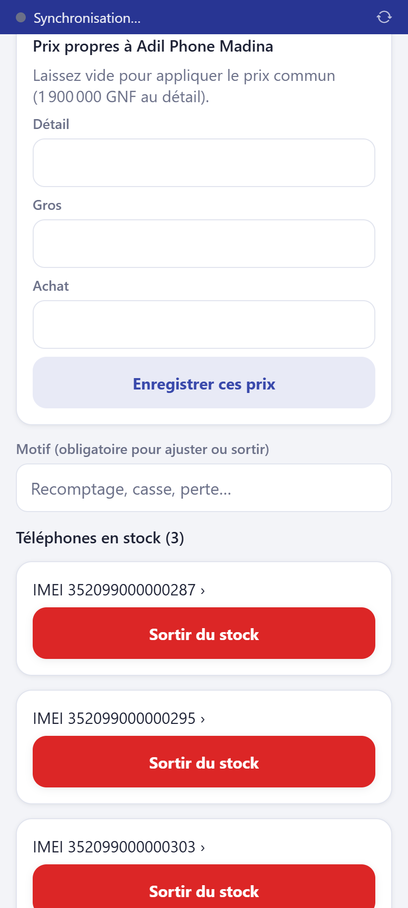
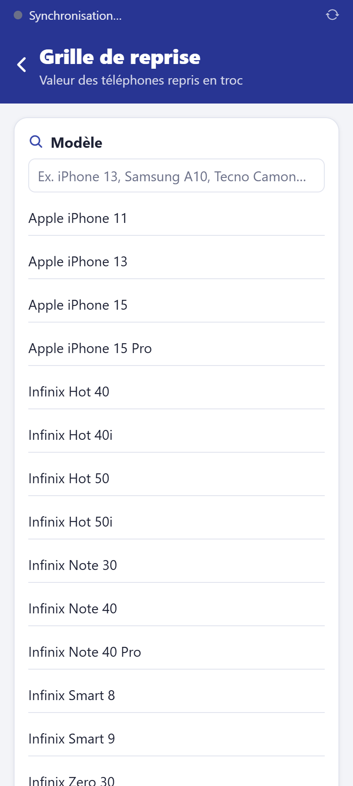

# Fixer les prix

**Qui :** gérant et propriétaire (jamais le vendeur). **Réseau :** pas nécessaire.

## Prix communs

Chaque produit a trois prix, valables dans toutes les boutiques :

- **Achat** : votre coût (sert au calcul du bénéfice ; invisible pour les vendeurs) ;
- **Détail** : le prix normal ;
- **Gros** : appliqué automatiquement à un client grossiste, ou dès que la quantité
  atteint le **seuil de gros** du produit.

Stock → produit → **Modifier la fiche**.

## Prix propres à une boutique

Une boutique peut vendre plus cher ou moins cher que les autres (loyer, concurrence) :
sur la fiche du produit, carte **Prix propres à …** (la boutique active), tapez les prix
voulus puis **Enregistrer ces prix**. Le prix de la boutique **remplace** le prix commun
dans cette boutique seulement. **Revenir aux prix communs** les efface.

## Beaucoup de prix d'un coup

Stock → **Importer (Excel)** : un classeur avec une ligne par produit (colonnes indiquées à l'écran) ; une **simulation** montre ce qui sera créé ou modifié avant l'import réel.

## Remises et reprises

- Le vendeur accorde seul une remise jusqu'à 5 % ; le gérant jusqu'à 15 % ; au-delà, le
  propriétaire.
- La **grille de reprise** (accueil → Grille de reprise) fixe la valeur d'un ancien
  téléphone en troc selon son modèle, sa capacité et son état. Sans grille, l'application
  propose une part du prix du neuf (60 % en excellent état, 15 % en mauvais état).

Chaque changement de prix est inscrit au journal d'audit, avec l'ancien et le nouveau prix.
