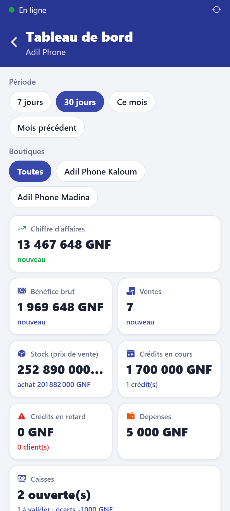
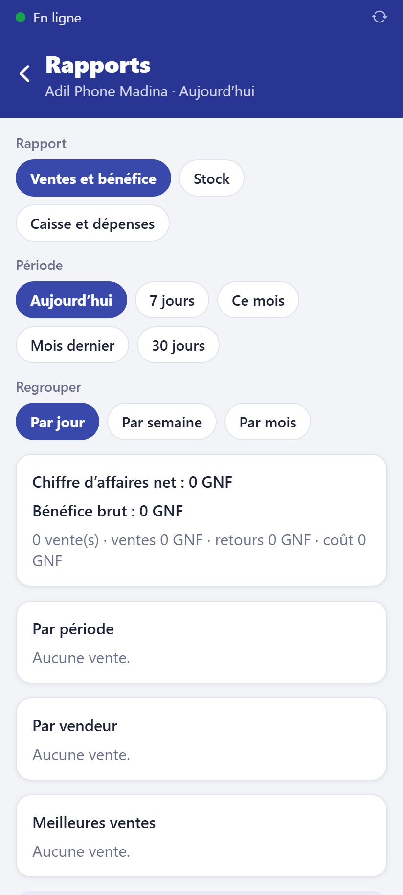
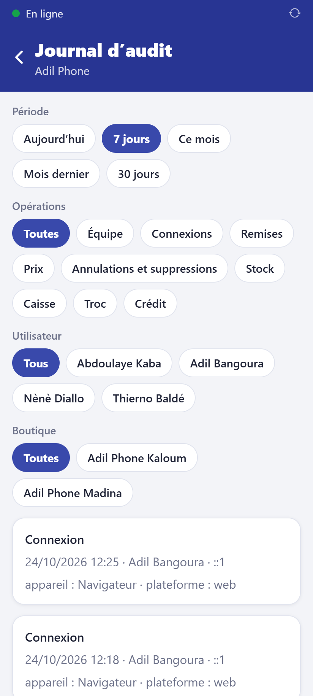

# Lire les rapports et le tableau de bord

**Qui :** propriétaire (toutes les boutiques) et gérant (les siennes).

## Le tableau de bord

Accueil → **Tableau de bord** (en ligne). Choisissez la **période** (7 jours, 30 jours, ce
mois, mois précédent) et **toutes les boutiques** ou une seule.

Sur un seul écran :

- **chiffre d'affaires**, **bénéfice brut**, nombre de ventes, avec l'**évolution** par
  rapport à la période précédente ;
- **valeur du stock** (prix de vente et d'achat) ;
- **crédits en cours** et **en retard** (montant échu, nombre de clients) ;
- **dépenses**, caisses ouvertes, à valider, écarts ;
- **par boutique** : barres pour comparer, et la **dernière synchronisation** (en orange si
  elle date de plus de deux jours : un appareil est peut-être resté hors ligne) ;
- l'**évolution** du chiffre d'affaires par jour ou par semaine ;
- les **trocs** : repris, réparés, revendus, et la **marge** réalisée.

**Exports** : **Imprimer (PDF)**, **Classeur Excel**. Les **rapports planifiés** (chaque
semaine et chaque mois) sont prêts à télécharger sans rien faire.

## Les rapports d'une boutique

Accueil → **Rapports** (fonctionne hors ligne, sur les données de l'appareil) :

- **Ventes** : chiffre d'affaires net, bénéfice brut, **par période**, **par vendeur**,
  **meilleures ventes** ;
- **Stock** : valeur, produits **sans vente depuis** 30, 60 ou 90 jours ;
- **Caisse** : encaissements par moyen, dépenses, caisses.

**Exporter en Excel** pour chaque rapport.

## Le journal d'audit

Accueil → **Journal d'audit** : remises, changements de prix, annulations, archivages,
ajustements de stock, connexions, crédits, trocs, transferts, équipe. Filtres par
personne, boutique, famille d'actions et période.

