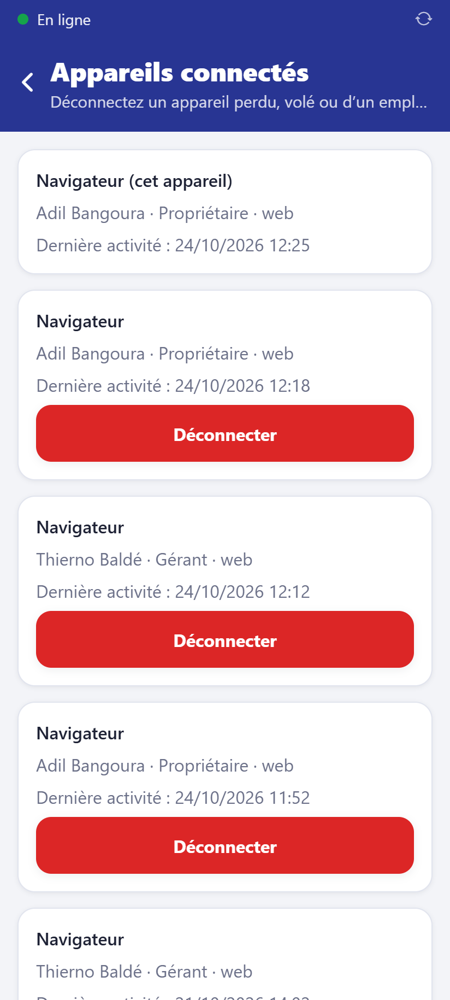

# Appareil perdu ou volé

Les données ne sont pas perdues : le serveur garde tout ce qui a été synchronisé et le
sauvegarde chaque jour. Sur le téléphone, la base de l'application est chiffrée.

## Tout de suite : couper l'accès

Accueil → **Appareils connectés** (propriétaire ou gérant) : repérez l'appareil (nom,
utilisateur, dernier accès) et touchez **Déconnecter**. Il ne peut plus rien envoyer ni
recevoir ; il faudrait l'identifiant **et** le mot de passe pour s'y reconnecter.

Si le mot de passe a pu être vu : **Équipe** → l'employé → **Nouveau mot de passe**.

## Reprendre sur un nouvel appareil

1. Installez l'application (ou ouvrez le site) sur le nouvel appareil.
2. Connectez-vous avec l'identifiant et le mot de passe, puis choisissez le code PIN.
3. Les données de vos boutiques arrivent du serveur : catalogue, stock, clients, ventes
   récentes, crédits, trocs, transferts, caisses.

## Ce qui peut manquer

Les opérations faites **hors ligne** sur l'appareil perdu et **jamais synchronisées** ne
sont pas sur le serveur. Pour les retrouver :

- regardez dans **Synchronisation** sur les autres appareils et dans le journal d'audit
  la dernière activité de l'appareil perdu ;
- comparez la caisse du vendeur avec ses reçus papier ;
- refaites les ventes manquantes à partir des reçus, si nécessaire.

D'où l'intérêt de laisser les appareils se synchroniser souvent (Wi-Fi de la boutique,
données mobiles).

## Si c'est un téléphone du stock qui est volé

Stock → produit → **Sortir du stock** avec le motif « Vol » ; ajoutez son IMEI aux
**IMEI signalés** pour qu'il ne revienne pas en troc.
