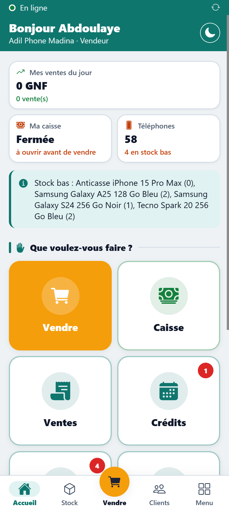
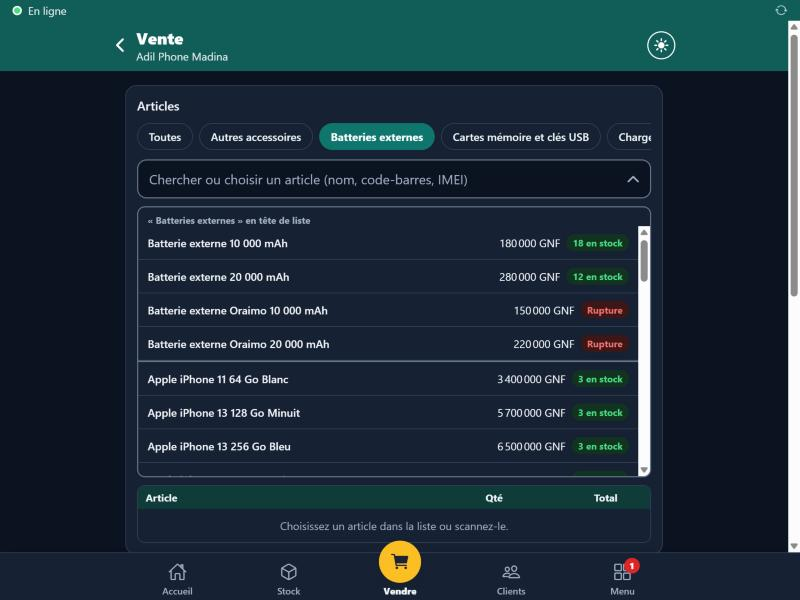
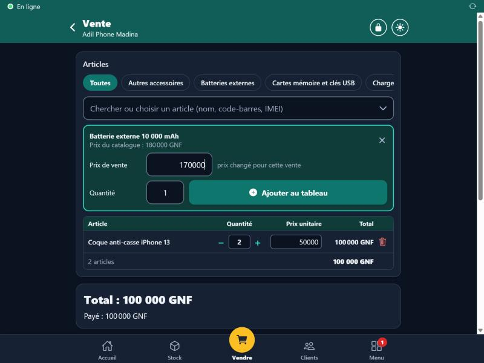
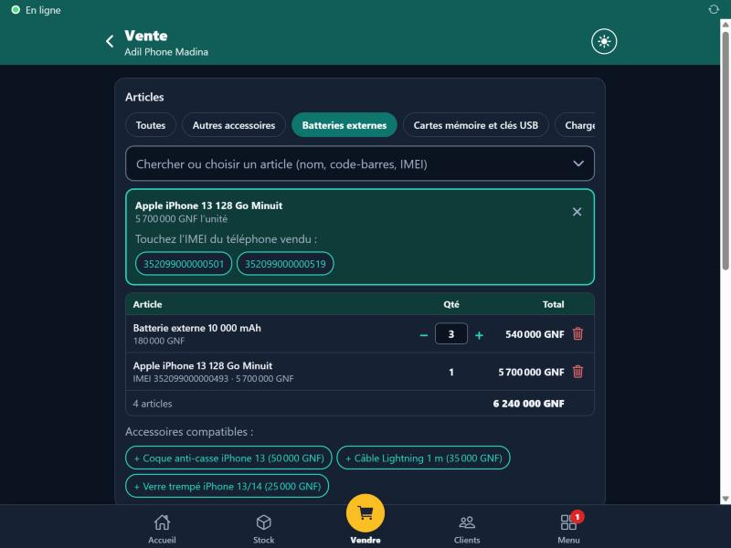
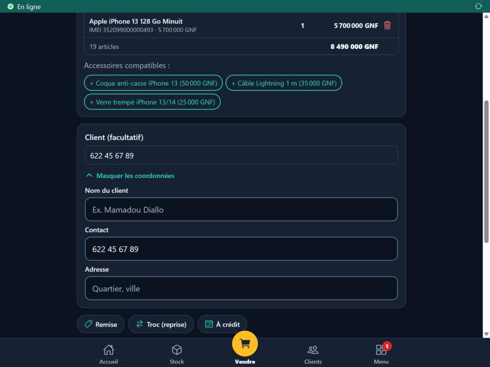
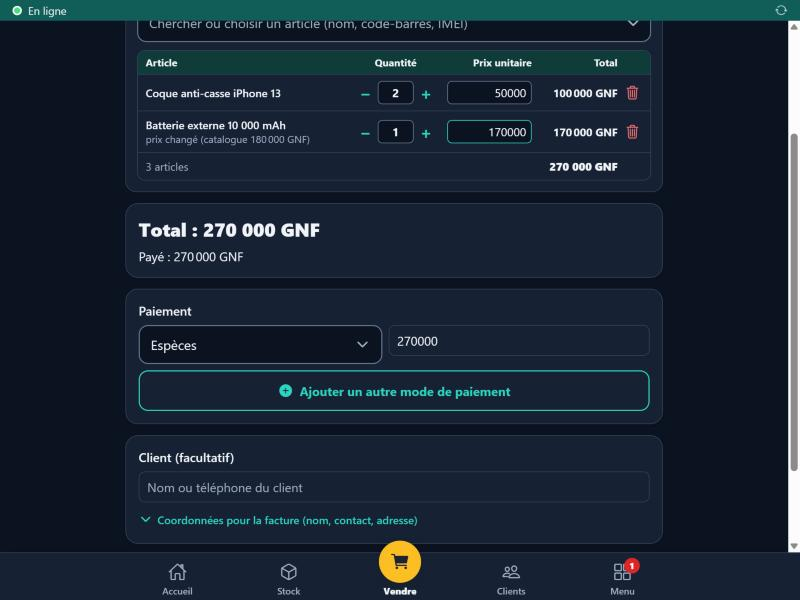

# Vendre

**Qui :** tout le personnel. **Réseau :** pas nécessaire.

Avant la première vente de la journée, [ouvrez votre caisse](04-caisse.md).

## 1. Ouvrir l'écran de vente

Touchez le gros bouton jaune **Vendre** : au centre de la barre du bas (toujours visible) ou en haut de l'accueil.

## 2. Choisir les articles

Tous les articles sont dans **une seule liste déroulante**, en haut de la carte
**Articles** :

1. Touchez la liste (ou la flèche) pour la dérouler, ou **tapez** pour chercher : un nom
   (« A15 »), un détail (« 128 Go noir »), un code-barres ou un IMEI. Chaque ligne indique
   le prix et le stock : « 3 en stock » ou **Rupture**.
2. **Boutons de catégorie** (Coques, Chargeurs, Smartphones…) : touchez-en un, la liste se
   déroule avec les articles de cette catégorie **en tête** (les autres restent en dessous,
   après un trait). Touchez **Toutes** pour revenir à l'ordre normal.

   

3. Touchez l'article. Sous la liste apparaît :
   - le **Prix de vente**, rempli avec le prix du catalogue : changez-le si vous vendez à un
     autre prix (prix négocié, prix arrondi) ;
   - **Accessoire** : la **quantité** (déjà sélectionnée : tapez simplement le nombre), puis
     **Ajouter au tableau** (ou la touche Entrée) ;
   - **Téléphone** : ses **IMEI** disponibles ; touchez celui du téléphone vendu. Pour les
     téléphones reçus sans IMEI, une quantité « Sans IMEI » est proposée.

   La croix ✕ annule le choix.

   

Les articles s'ajoutent au **tableau** sous la liste, en quatre colonnes : **Article**,
**Quantité**, **Prix unitaire**, **Total**, et le total général en bas.

- **Changer une quantité** : touchez **−** ou **+**, ou tapez directement le nombre dans la
  case. La quantité ne peut pas dépasser le stock (un message l'indique).
- **Changer un prix** : tapez le nouveau prix dans la case **Prix unitaire** (vide : retour
  au prix du catalogue). La ligne indique « prix changé (catalogue …) ».
- **Retirer un article** : la corbeille 🗑 au bout de la ligne (ou la quantité à 0).
- Un téléphone choisi par son IMEI compte toujours pour 1.
- Le prix de gros s'applique tout seul à partir du seuil du produit (« prix de gros »).
- **Prix plus bas** : un vendeur ou un gérant peut baisser un prix jusqu'à son plafond de
  remise (par exemple 10 %). Plus bas, l'application refuse : passez par une **Remise**
  validée par le gérant. Chaque prix changé est noté au **Journal** (« Vente à un prix
  différent »).
- Après un téléphone, ses **accessoires compatibles** sont proposés sous le tableau.

> Avec un lecteur de codes-barres (ordinateur) ou le bouton **code-barres** à droite de la
> liste (téléphone) : scannez, l'article s'ajoute directement au tableau.

## 3. Paiement

Juste sous les articles : le **total** et le **paiement**. Le montant en **Espèces** est
rempli **tout seul** avec le total, et suit chaque article ajouté, chaque prix ou remise.
Changez-le si besoin : le client donne plus (la monnaie à rendre s'affiche), ou paie
autrement. Choisissez un autre **mode** dans la liste (Orange Money, MTN MoMo,
virement…), ou **Ajouter un autre mode de paiement** pour un paiement en deux fois. Pour
Orange Money, MTN MoMo et virement, notez la **référence** de la transaction. **Tout en
espèces** remet le total en espèces.

## 4. Client, options

- **Client (facultatif)** : un seul champ, **Nom ou téléphone du client**. Un client
  enregistré apparaît pendant que vous tapez : touchez-le (un client grossiste reçoit
  automatiquement le prix de gros ; sa facture peut lui être envoyée par SMS ou WhatsApp).
  Un client de passage : ce que vous tapez sert de nom (ou de contact si c'est un numéro).
- **Coordonnées pour la facture (nom, contact, adresse)** : touchez cette ligne pour
  dérouler les trois champs et les compléter. Ils sont remplis tout seuls pour un client
  enregistré ; un ✓ indique qu'ils contiennent déjà quelque chose.

  

- Trois boutons d'**options** sous le client, à toucher seulement si besoin (le montant du
  paiement se recalcule tout seul) :
  - **Remise** : vous pouvez accorder jusqu'au pourcentage indiqué. Au-delà, un gérant
    valide avec son identifiant et son code PIN. Retouchez le bouton pour l'enlever.
  - **Troc (reprise)** : voir [Faire un troc](02-troc.md).
  - **À crédit** : apport et tranches, voir
    [Encaisser une tranche](03-encaisser-une-tranche.md).

## 5. Encaisser

Touchez **Encaisser**, en bas de l'écran. L'écran affiche la monnaie à rendre et le numéro de facture, puis
demande : **« Imprimer une facture pour le client ? »**

- **Non** : la vente est terminée (le reçu reste disponible).
- **Oui, faire la facture** : le **nom**, le **contact** et l'**adresse** du client
  deviennent **obligatoires**. Complétez ce qui manque puis touchez **Enregistrer et
  imprimer la facture** : la facture A4 s'ouvre à l'impression (sur ordinateur, choisissez
  **Enregistrer au format PDF** pour la garder). Sur téléphone, **Partager la facture (PDF)**
  l'envoie par WhatsApp, e-mail…

Touchez **Reçu, facture, WhatsApp…** pour imprimer le ticket ou envoyer la facture.

## 6. Retrouver ses factures

Menu → **Factures** : toutes les factures émises de la boutique, avec une recherche par
numéro, nom ou contact du client. Chaque facture a deux boutons :

- **Modifier** : corriger le nom, le contact ou l'adresse du client ;
- **Imprimer** : réimprimer la facture A4 (ou l'enregistrer en PDF).

Une vente sans facture peut en recevoir une plus tard : ouvrez la vente puis **Faire la
facture du client**. Un vendeur ne modifie que les factures de ses propres ventes.

## À retenir

- La vente est enregistrée **tout de suite**, même sans Internet.
- Un téléphone vendu ne peut plus être vendu, même dans une autre boutique.
- Erreur de saisie après l'encaissement : prévenez le gérant, lui seul peut annuler.
