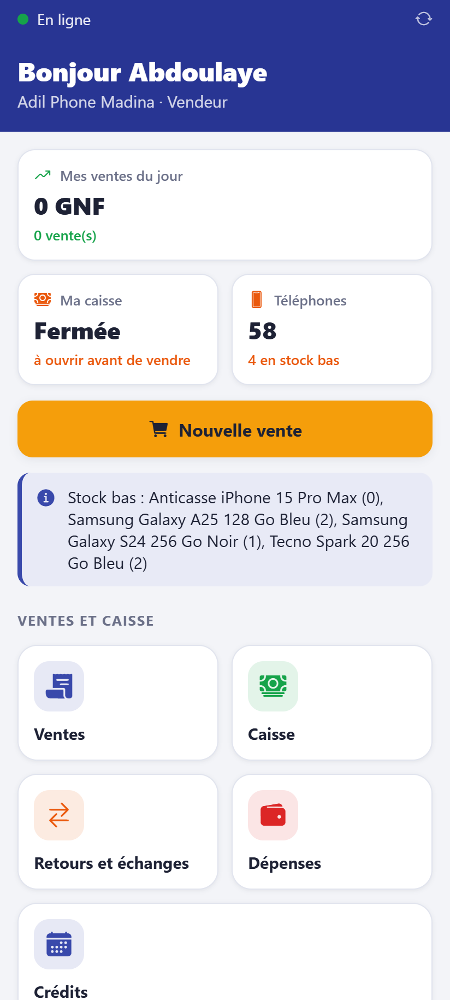
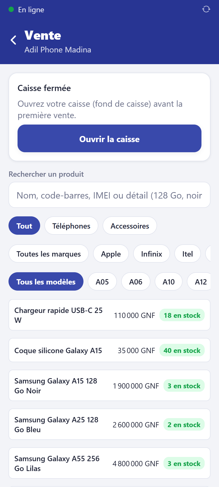
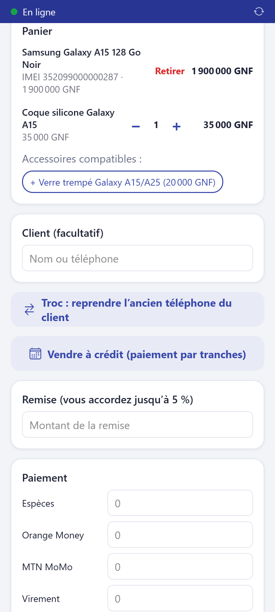
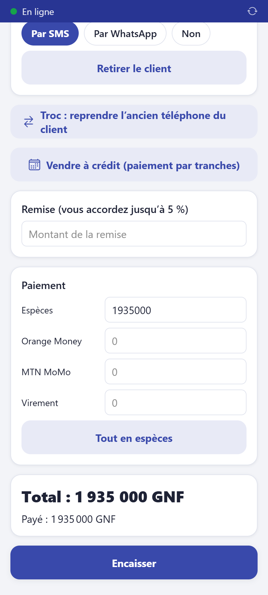

# Vendre

**Qui :** tout le personnel. **Réseau :** pas nécessaire.

Avant la première vente de la journée, [ouvrez votre caisse](04-caisse.md).

## 1. Ouvrir l'écran de vente

Sur l'accueil, touchez le grand bouton jaune **Nouvelle vente**.

## 2. Trouver le produit

Tapez dans la recherche : un nom (« A15 »), un détail (« 128 Go noir »), un code-barres ou
un IMEI. Les résultats apparaissent pendant que vous tapez. Pour aller plus vite, touchez
les pastilles : **Téléphones** ou **Accessoires**, puis la **marque**, puis le **modèle**.
Le choix d'un modèle affiche aussi ses accessoires (coques, verres trempés).

Chaque résultat indique le stock : « 3 en stock » ou **Rupture**.

- **Téléphone :** choisissez ensuite son **IMEI** dans la liste (ou scannez-le).
- **Accessoire :** il s'ajoute au panier ; ajustez la quantité avec **−** et **+**.

> Avec un lecteur de codes-barres sur ordinateur : scannez simplement, le produit
> s'ajoute tout seul.

## 3. Client, remise

- **Client (facultatif)** : tapez son nom ou son téléphone. Un client grossiste reçoit
  automatiquement le prix de gros. Avec un client, la facture peut lui être envoyée par
  SMS ou WhatsApp.
- **Remise** : vous pouvez accorder jusqu'au pourcentage indiqué. Au-delà, un gérant
  valide avec son identifiant et son code PIN.

## 4. Encaisser

Saisissez ce que le client donne dans chaque moyen de paiement (espèces, Orange Money,
MTN MoMo, virement ; plusieurs moyens possibles). Pour Orange Money, MTN MoMo et
virement, notez la **référence** de la transaction. **Tout en espèces** remplit le total.

Touchez **Encaisser**. L'écran affiche la monnaie à rendre et le numéro de facture.
Touchez **Reçu, facture, WhatsApp…** pour imprimer le ticket ou envoyer la facture.

## À retenir

- La vente est enregistrée **tout de suite**, même sans Internet.
- Un téléphone vendu ne peut plus être vendu, même dans une autre boutique.
- Erreur de saisie après l'encaissement : prévenez le gérant, lui seul peut annuler.
