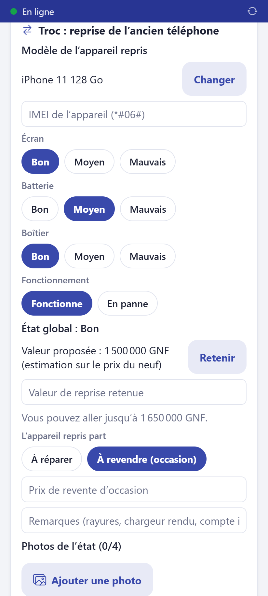
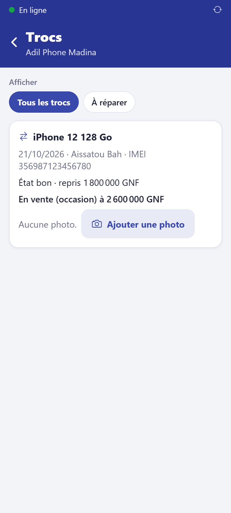

# Faire un troc

Le client donne son ancien téléphone : sa valeur est **déduite** du prix du neuf et il
paie la différence (comptant, ou à crédit).

**Qui :** tout le personnel. **Réseau :** pas nécessaire (sauf validation par le gérant).

## Ce qu'il faut

- La **fiche du client** avec sa **pièce d'identité** (type et numéro). Sans elle, le
  troc est refusé. Le bouton **Compléter la fiche client** y mène directement.
- L'ancien téléphone, allumé si possible, pour lire son IMEI (tapez **\*#06#**).

## Pas à pas

1. Dans la vente, ajoutez le téléphone neuf au panier et choisissez le **client**.
2. Touchez **Troc : reprendre l'ancien téléphone du client**.
3. **Modèle** : tapez-le (ex. « iPhone 11 128 ») et choisissez-le dans la liste.
4. **IMEI** : tapez les 15 chiffres. Un IMEI **signalé volé ou bloqué** est refusé
   (message rouge) : ne reprenez pas l'appareil.
5. **État** : écran, batterie, boîtier (bon, moyen, mauvais), fonctionne ou en panne.
   L'application calcule l'**état global** et propose une **valeur**.
6. Touchez **Retenir** pour garder la valeur proposée, ou tapez la valeur négociée. Vous
   pouvez monter de 10 % au plus ; au-delà, un gérant valide avec son code PIN.
7. **L'appareil repris part** : **À revendre** (indiquez le prix de revente d'occasion)
   ou **À réparer**.
8. Ajoutez des **photos** de l'état (rayures, écran) : 4 au plus.
9. Encaissez la **différence** comme une vente normale.

Le total affiche « Reprise (troc) : − … » puis **À payer**.

## Ensuite

L'ancien téléphone entre dans le stock de la boutique (occasion). L'écran **Trocs**
liste les appareils repris, leurs photos, et permet au gérant de **remettre en vente**
un appareil réparé.

