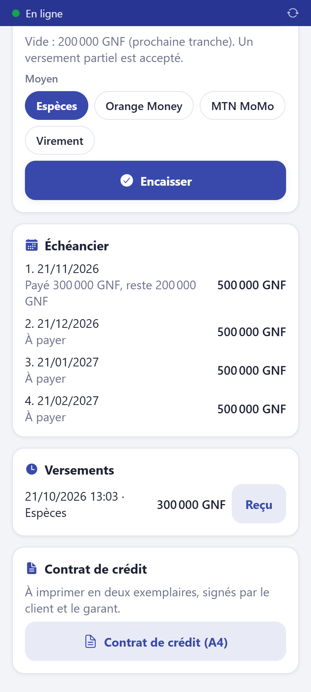
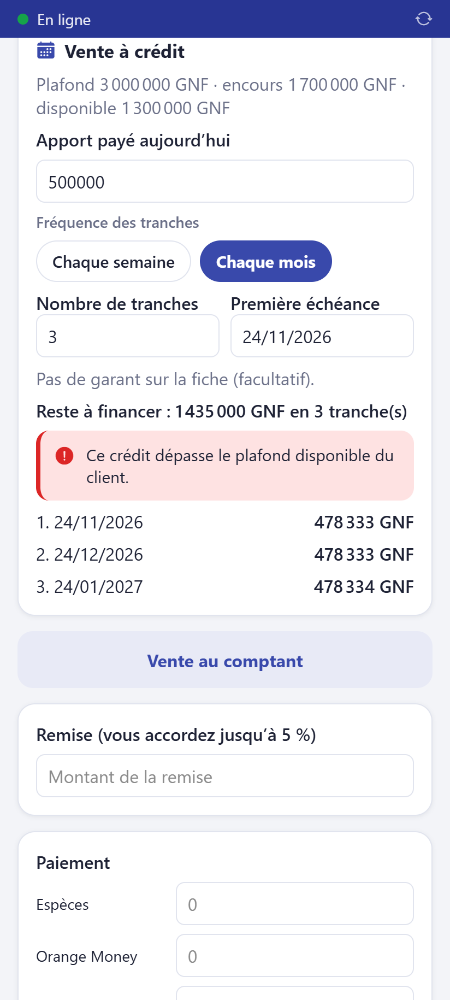

# Encaisser une tranche de crédit

**Qui :** tout le personnel. **Réseau :** pas nécessaire.

Votre caisse doit être ouverte : l'argent de la tranche y est compté.

## Pas à pas

1. Sur l'accueil, touchez **Crédits**. Le badge rouge indique les clients en retard.
2. Touchez le client. La fiche montre le **reste dû**, la prochaine tranche et
   l'échéancier.

| Liste des crédits                 | Fiche du crédit                      |
| --------------------------------- | ------------------------------------ |
|  |  |

3. Dans **Encaisser une tranche**, tapez le montant versé. Laissé vide, le montant
   proposé est celui qui est dû aujourd'hui. Un **versement partiel** est accepté : il
   paie d'abord la tranche la plus ancienne.
4. Choisissez le moyen (référence obligatoire pour Orange Money, MTN MoMo, virement).
5. Touchez **Encaisser**.

Le message vert indique le nouveau **reste dû**. La carte **Reçu de la tranche** permet
d'imprimer le ticket : il porte le montant versé, le reste dû et la date de la prochaine
tranche. Remettez-le au client.

## À savoir

- Le client reçoit des rappels par SMS avant chaque échéance et en cas de retard.
- Le dernier versement **solde** le crédit automatiquement.
- Une vente à crédit se fait depuis l'écran de vente : bouton **Vendre à crédit**
  (apport, nombre de tranches, chaque semaine ou chaque mois). Il faut la fiche complète
  du client (pièce d'identité, adresse) et un plafond fixé par le propriétaire.

