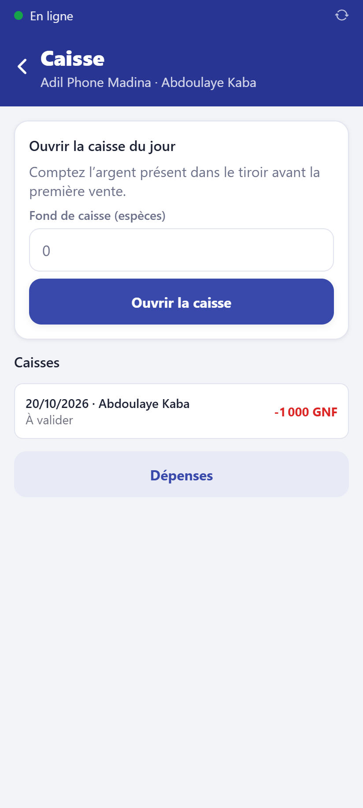

# Ouvrir et fermer la caisse

Chaque vendeur a **sa** caisse de la journée. Ventes, tranches de crédit, retours et
dépenses y sont comptés automatiquement.

**Qui :** tout le personnel. **Réseau :** pas nécessaire.

## Le matin : ouvrir

1. Accueil → **Caisse**.
2. **Fond de caisse (espèces)** : comptez la monnaie que vous avez au départ.
3. Touchez **Ouvrir la caisse**.

Sans caisse ouverte, l'application refuse d'encaisser.

## Pendant la journée : les dépenses

Une dépense payée avec l'argent de la caisse (taxi, crédit téléphonique…) se note dans
**Dépenses** : catégorie, libellé, montant. Photographiez le reçu si vous l'avez.

## Le soir : clôturer

1. Accueil → **Caisse** → **Clôture : comptez chaque moyen de paiement**.
2. Comptez réellement l'argent et tapez, pour chaque moyen, ce que vous avez :
   espèces, Orange Money, MTN MoMo, virement.
3. L'application affiche l'**attendu** et l'**écart**. S'il y a un écart, même petit,
   expliquez-le dans le **commentaire** (obligatoire).
4. Touchez **Clôturer la caisse** et imprimez le ticket de clôture.

Le gérant **valide** ensuite la caisse. Un écart n'est pas une faute s'il est expliqué.
