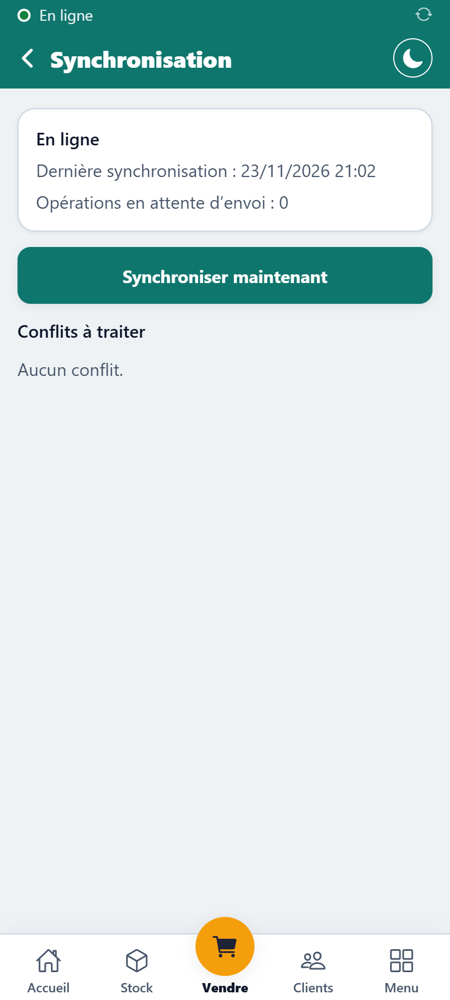

# Que faire hors ligne

**Rien de spécial : continuez à travailler.**

## Ce qui marche sans Internet

- vendre, au comptant, à crédit, avec un troc ;
- encaisser une tranche ;
- ouvrir et fermer la caisse, noter une dépense ;
- chercher un produit ou un IMEI, consulter le stock ;
- imprimer un reçu (imprimante Bluetooth) ;
- déverrouiller l'application avec le code PIN.

Tout est gardé sur l'appareil et part au serveur **automatiquement** au retour du réseau.

## Ce qui attend le réseau

- l'envoi des factures par SMS ou WhatsApp (il part plus tard, tout seul) ;
- la validation d'une remise ou d'un troc par le code PIN du gérant ;
- les photos des trocs et des justificatifs ;
- le tableau de bord du propriétaire, le journal d'audit.

## Le bandeau du haut

Touchez-le pour ouvrir l'écran **Synchronisation** : opérations en attente, dernière
synchronisation, et le bouton **Synchroniser maintenant**.

## Les messages à l'écran

- **Mode hors ligne** (bandeau bleu) : pas d'Internet. Continuez ; le nombre d'opérations
  qui partiront au retour du réseau est indiqué.
- **Échec de la synchronisation** (bandeau rouge) : la raison est écrite en clair (pas de
  connexion, serveur indisponible…). Rien n'est perdu : l'envoi reprend tout seul.
- **Aucune synchronisation depuis 7 jours ou plus** (bandeau rouge) : connectez l'appareil
  à Internet (Wi-Fi ou données) dès que possible, puis touchez **Synchroniser maintenant**.

## Une opération refusée

Rarement, le serveur refuse une opération faite hors ligne : par exemple, le même
téléphone a été vendu entre-temps dans une autre boutique. L'appareil reprend alors
l'état du serveur et l'opération apparaît en rouge dans **Synchronisation**, avec la
raison. Le gérant en est prévenu (**Conflits à traiter**). Prévenez-le aussi de vive voix
si un client est concerné.

## Conseils

- Ne vous déconnectez pas avec des opérations en attente : attendez qu'elles partent.
- Gardez l'heure de l'appareil juste (réglage automatique).
